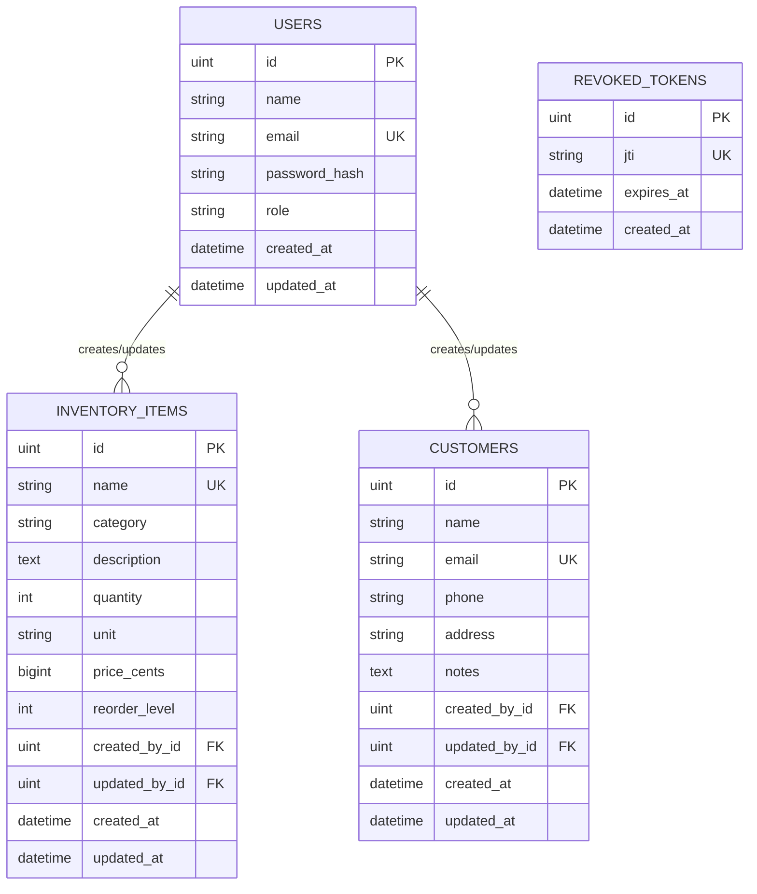

# ER Diagram

## Entity Descriptions

### users
Stores authenticated users with roles (Owner, Manager, Cashier). Passwords are stored as bcrypt hashes.

### inventory_items
Inventory items with pricing in cents, stock levels, reorder levels, and computed low_stock status.

### customers
Customer records with optional unique email and required phone.

### revoked_tokens
Stores revoked JWT JTIs for logout functionality.
